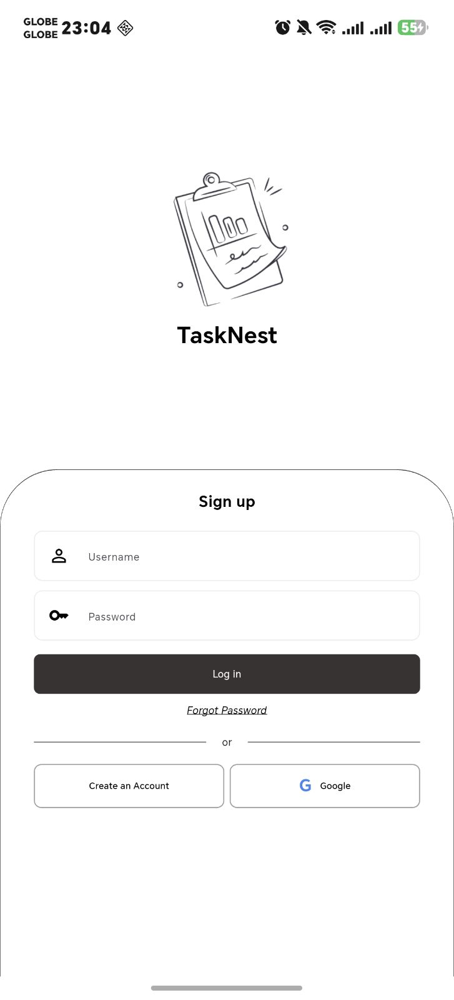

# Week 14: Flutter Foundations & Static UI

**Student Name:** Althea Chua  
**Block:** 3.1BSIT  
**Activity:** Week 14 Activity

## Project Overview

This project is part of the Week 14 Flutter activity. It focuses on applying Flutter fundamentals and creating static user interface screens based on the original Figma designs created during Week 1–2.

The project uses Flutter widgets to build the TaskNest application's Login Screen and Welcome Screen.

## Objectives

- Understand the basic structure of a Flutter application.
- Apply Flutter widgets to create user interfaces.
- Use layout widgets to arrange screen elements.
- Apply images and other visual assets.
- Recreate the original Figma designs using Flutter.
- Understand parent-child relationships through a Widget Tree.

## Screens Developed

### 1. Login Screen

The Login Screen contains:
- TaskNest application logo
- Login heading
- Username and password fields
- Login button
- Forgot Password text
- Create Account button
- Google button

### 2. Welcome Screen

The Welcome Screen contains:
- Welcome heading
- Personalized greeting
- Image placeholder
- Continue button with an arrow icon

## Technologies Used

- Flutter
- Dart
- Visual Studio Code
- Android Device for Testing
- Figma for UI Design Reference

## Project Structure

```text
tasknest/
│
├── assets/
│   └── images/
│       └── task-nest-icon.png
│
├── lib/
│   ├── main.dart
│   └── screens/
│       ├── login_screen.dart
│       └── welcome_screen.dart
│
├── pubspec.yaml
└── README.md
```

## Screenshots

### Login Screen



### Welcome Screen


## Figma Design Reference

Original UI designs created during Week 1–2:

[Insert your Figma project link here]

## Widget Tree

The Widget Tree PDF illustrates the parent-child relationships and the main Flutter widgets used in the Login Screen and Welcome Screen.

**File:** `Widget_Tree.pdf`

## How to Run the Project

1. Clone this repository:

```bash
git clone YOUR_GITHUB_REPOSITORY_URL
```

2. Open the project folder:

```bash
cd tasknest
```

3. Install the project dependencies:

```bash
flutter pub get
```

4. Run the application:

```bash
flutter run
```

## Learning Outcomes

Through this activity, I learned how to use Flutter widgets to build static user interfaces, organize screen layouts, display image assets, and structure widgets using parent-child relationships.

This activity also helped me practice translating my Figma designs into Flutter screens.
